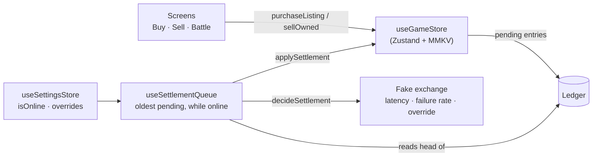

# StableMate

A single-player Pokémon trading game that is really a **money app with a game skin**. You start with one Pokémon and $0, win battles for prize money, and buy and sell Pokémon on a market. Every cash movement goes through a ledger that handles the hard parts of real payments: **pending vs settled transactions, held funds, failures, refunds and offline queuing**.

The game is the hook; the transaction model is the point.

## What to look at

| If you're interested in… | Look at |
|---|---|
| How money moves | [`src/store/game.ts`](StableMate/src/store/game.ts): holds, pending sales, `applySettlement` |
| Offline / optimistic behaviour | [`src/api/useSettlementQueue.ts`](StableMate/src/api/useSettlementQueue.ts), [`src/api/settlement.ts`](StableMate/src/api/settlement.ts) |
| Global state | [`src/store/`](StableMate/src/store): two persisted Zustand stores |
| Tests | [`__tests__/`](StableMate/__tests__), [`test/fixtures.ts`](StableMate/test/fixtures.ts), [`TEST_SCENARIOS.md`](TEST_SCENARIOS.md) |
| Something fun | [`BattleOverlay.tsx`](StableMate/src/modules/active/screens/PokemonDetail/BattleOverlay.tsx): a Reanimated battle sequence |

## Demo script (about 3 minutes)

1. **Onboarding.** Swipe through, pick a starter. You have $0 and one Pokémon.
2. **Battle.** Stable → your starter → Battle. A win pays a prize into the ledger (History) and raises the Pokémon's mark price; a loss lowers it.
3. **Buy.** Win a few battles, then Buy → pick a listing. Cash drops immediately (a **hold**), the Pokémon shows `Buying · pending`, then settles about 1.5s later.
4. **Go offline.** Options → turn off *Simulate network*. Buy or sell: it's accepted, held and queued. Turn the network back on and watch the queue drain, oldest first.
5. **Force a failure.** Options → *Settlement outcome: Always fail*. A failed purchase is refunded with its own ledger entry; a failed sale puts the Pokémon back. An alert says what happened.
6. **Inspect.** History shows pending entries first, then posted activity. Tap any row for its receipt. Overview shows cash, sales still pending, net worth and a cash-over-time chart.

Options also has *Battle outcome: Always win / Always lose*. The two overrides reset to *Random* on every launch; the network toggle persists.

## How money works



- **Purchases are holds.** Buying debits cash immediately and records a `pending` purchase. You can't spend the same money twice, online or offline. On settlement the hold simply becomes final.
- **Sales credit on settlement.** A sale is `pending` with no balance until it clears, so you can't spend proceeds you don't have yet. Overview and History show them separately as *pending from sales*.
- **The ledger is append-only.** A failed purchase isn't edited away. It's marked `failed`, and a separate `refund` entry returns the money. Each posted entry records `balanceAfter`, and the entries always add up (checked by `expectRunningBalances` in every money test).
- **The ledger is the queue.** Pending entries in the persisted ledger *are* the offline queue. Nothing is duplicated into a second store, so it survives restarts for free. The queue settles one transaction at a time, oldest first, only while online.
- **Battles settle before they animate.** `startBattle` rolls and records the result, then the overlay replays it, so quitting mid-animation can't undo a loss.
- **Rules that keep it honest:**
  - a Pokémon with a pending transaction can't battle or be sold
  - you can't sell your last Pokémon (you'd have nothing to earn with)
  - settling the same transaction twice does nothing
- **Net worth = cash + the stable at mark price.** A sale swaps a Pokémon for exactly its mark price, so net worth doesn't move when you sell.

## Decisions and trade-offs

- **Zustand for state, React Query only for the market.** Game state is local, synchronous and needs to persist, which is a store's job. React Query holds the per-round market lot (a stand-in for a real market API) and persists it, so the lot is stable within a round.
- **No backend.** The "exchange" is [`decideSettlement`](StableMate/src/api/settlement.ts): a delay, a failure rate (10% for purchases, 20% for sales) and an override. It behaves enough like a remote service to make optimistic UI meaningful, and a real API could slot in behind the same function.
- **Holds, not fully optimistic.** Letting both buys and sells move cash immediately would be simpler, but it lets you spend money that might never arrive and can push the balance negative. Holds match how card payments actually work.
- **Determinism through the app, not around it.** The demo overrides double as E2E test controls, so Maestro can force wins, losses and failures without mocks or a test server.
- **Text-first tests.** Integration tests assert on what the user reads, not testIDs, so they also check the copy.

## Testing

```bash
cd StableMate
npm test        # full suite, a few seconds
npx tsc --noEmit
```

- **Integration (RNTL).** These render the **real** file-based app via `expo-router/testing-library`, deep-link to a screen, and drive it with presses. They cover onboarding, battles, buying, selling, the offline queue, failures and refunds, History ordering, running balances and receipts. Randomness is pinned by seeding the market and game state ([`test/fixtures.ts`](StableMate/test/fixtures.ts)) or by spying on the challenger picker, and settlement runs on fake timers.
- **Store logic.** [`store.test.ts`](StableMate/__tests__/store.test.ts) exercises holds, refunds, sale posting order, rollback and idempotency directly.
- **The tests can fail.** I checked by introducing bugs (no sale credit, no refund, settling while offline); each one broke between 2 and 5 tests.
- **Scenarios.** [`TEST_SCENARIOS.md`](TEST_SCENARIOS.md) lists every scenario, tagged for RNTL, Maestro or both, with ✅ against those that are automated.

Harness notes for anyone extending it: native tabs keep every tab mounted, so queries are scoped with `withinTab(...)` / `withinScreenContaining(...)`. [`jest.setup.ts`](StableMate/jest.setup.ts) explains the Reanimated 4 / jest-expo workaround.

## Running it

The app uses native modules (MMKV via Nitro, Reanimated), so it needs a **development build**; Expo Go won't work.

```bash
cd StableMate
npm install
npx expo run:ios       # or: npx expo run:android
npm start              # subsequent runs, once the dev build is installed
```

## Stack

Expo SDK 58 · React Native 0.88 · React 19.3 with the React Compiler · Expo Router (native tabs, typed routes) · Zustand 5 · TanStack Query 5 · MMKV · Reanimated 4 · Zod (validates the bundled catalog) · Jest + React Native Testing Library 14.

Species data is a 30-Pokémon snapshot from [PokéAPI](https://pokeapi.co), checked into the repo so the app works offline. Regenerate it with `npm run catalog:fetch`.

## Known limitations

- **Money is whole dollars.** Amounts are integers, but not minor units (cents), and they aren't locale-formatted (`$1234`, not `$1,234`).
- **Light mode only.** Colours are hard-coded rather than themed.
- **The chart is drawn with Views.** This avoids a native dependency and a dev-client rebuild; it should move to SVG.
- **No E2E flows or CI yet.** The scenarios are written and tagged for Maestro but not automated.

## What I'd build next

- **Pay in 4.** Split a purchase into instalments debited over the next rounds, with a missed-payment path when funds are short. It reuses holds, pending entries, the queue and the receipt.
- Maestro flows for the tagged scenarios, plus CI running typecheck, lint and tests.
- Integer minor units with a single `formatMoney` helper, theme tokens with dark mode, and the SVG chart.
- Filters on History for open, closed and failed transactions, and a settlement timeline on the receipt.
